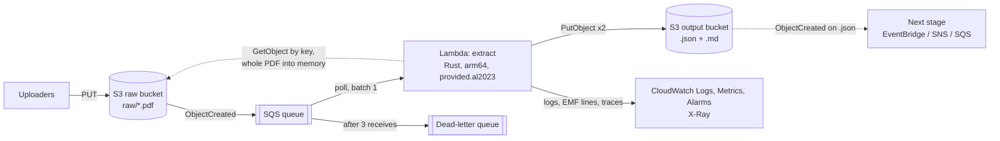

# pdf-extractor

Extracts the full content of PDFs of unknown structure (financial documents) into JSON and Markdown, using
[pdf_oxide](https://github.com/lsfera/pdf_oxide) in an AWS Lambda written in Rust.

```
S3 raw bucket ──► SQS (+ DLQ) ──► Lambda (Rust, arm64) ──► S3 output bucket
 raw/*.pdf                         one PDF per invocation     extracted/<key>.json + .md
```

| Folder | Contents |
|---|---|
| [lambda/](lambda/) | The extraction library and the Lambda binary (`bootstrap`). Per-page extraction with panic isolation, Markdown plus table grids, JSON tracing logs and CloudWatch EMF metrics. |
| [infra/](infra/) | Pulumi (Rust SDK) program: buckets, queues, IAM, Lambda, event source mapping, alarms. Also holds the Makefile that deploys to and tests against LocalStack. |
| [lambda/docs/](lambda/docs/) | Architecture diagram source ([draw.io](lambda/docs/pdf-extraction-pipeline.drawio)). |

Dependencies that are not published to crates.io are expected beside this folder:

```
<workspace>/
├── pdf-extractor/    this repository
├── pdf_oxide/        https://github.com/lsfera/pdf_oxide
└── pulumi-rust/      https://github.com/pulumi-labs/pulumi-rust  (experimental, unofficial)
```

## Architecture

PDFs land in S3, a queue absorbs bursts and retries, and one Rust Lambda per document writes structured JSON and
Markdown to a separate bucket.



The dashed line back to the raw bucket is the Lambda fetching the file named in the event, since the event carries only
the key. The next stage is outside this stack. An editable draw.io version is in
[lambda/docs/](lambda/docs/pdf-extraction-pipeline.drawio).

Settings the stack applies:

| Part | Setting |
|---|---|
| S3 → SQS | Notification for `ObjectCreated` on prefix `raw/`, suffix `.pdf`, plus a queue policy that lets the bucket send messages. |
| Output bucket | Separate from the input, so writing results can never re-trigger the pipeline. |
| Queue | Visibility timeout of 6× the Lambda timeout. Redrive to the DLQ after 3 receives. |
| Event source mapping | Batch size 1, so memory use follows one PDF. A `MaximumConcurrency` cap keeps a bulk upload from flooding downstream systems. |
| Lambda | arm64, `provided.al2023`, X-Ray active tracing. Memory is sized from the `Max Memory Used` line in the REPORT log. |
| IAM | Read on the raw bucket, write on the output bucket, receive/delete on the queue, log writes, X-Ray write. Nothing broader. |
| Alarms | Messages in the DLQ, `Failures`, `PagesFailed`, and `PagesScanned` (pages that need OCR). |

## Quick start

Needs Docker; everything else is installed in the test image.

```sh
make test   # lambda tests + end-to-end test against LocalStack; always tears the stack down
make up     # LocalStack on :4566 with the pipeline deployed, for manual PDF uploads; Ctrl-C tears it down
make down   # manual teardown if `make up` was killed hard
```

`make up` prints the bucket names and the upload commands, for example:

```sh
aws --endpoint-url http://localhost:4566 s3 cp my.pdf s3://<raw-bucket>/raw/my.pdf
aws --endpoint-url http://localhost:4566 s3 ls s3://<output-bucket>/ --recursive   # extracted/raw/my.pdf.json and .md
```

The first build is slow and needs several GB of RAM (it compiles the generated AWS SDK crate); later runs reuse
the Docker layer cache. LocalStack is pinned to the community image `4.14.0`; newer images require an auth token.

## Debugging the Lambda

Start `make up`, upload a PDF, then run **Debug PDF extract lambda (LocalStack)** from the Run and Debug panel
(CodeLLDB). It asks for the two bucket names and the object key. With `LOCAL_S3_BUCKET` and `LOCAL_S3_KEY` set the
binary processes that one object against LocalStack and exits, without the Lambda runtime. Inside the devcontainer
LocalStack is reached at `host.docker.internal:4566`; change `AWS_ENDPOINT_URL` in
[.vscode/launch.json](.vscode/launch.json) if that name does not resolve on your setup.

## Lambda configuration

| Variable | Default | Meaning |
|---|---|---|
| `OUTPUT_BUCKET` | required | Where results are written (must differ from the input bucket) |
| `OUTPUT_PREFIX` | `extracted/` | Key prefix for results |
| `MAX_PDF_BYTES` | 100 MiB | Larger objects are rejected |
| `TABLES_JSON` | on | `0` skips the table grids in the JSON |
| `PDF_PASSWORD` | unset | Password for encrypted PDFs |
| `S3_FORCE_PATH_STYLE` | off | `1` for LocalStack/MinIO |

## CI

[.github/workflows/localstack.yml](.github/workflows/localstack.yml) runs the same end-to-end test on an arm64
runner. It checks this repository out into `pdf-extractor/` with `pdf_oxide` and `pulumi-rust` beside it, at pinned
commits.

## Status

Validated against LocalStack only (upload, extraction, S3 filters, queue wiring, metrics line, destroy). Not yet
exercised: a message reaching the dead-letter queue after three failures, X-Ray tracing (not emulated by community
LocalStack) and a deployment to real AWS. See [infra/README.md](infra/README.md) for stack configuration.
